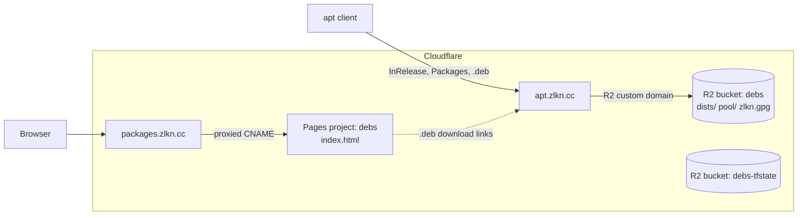
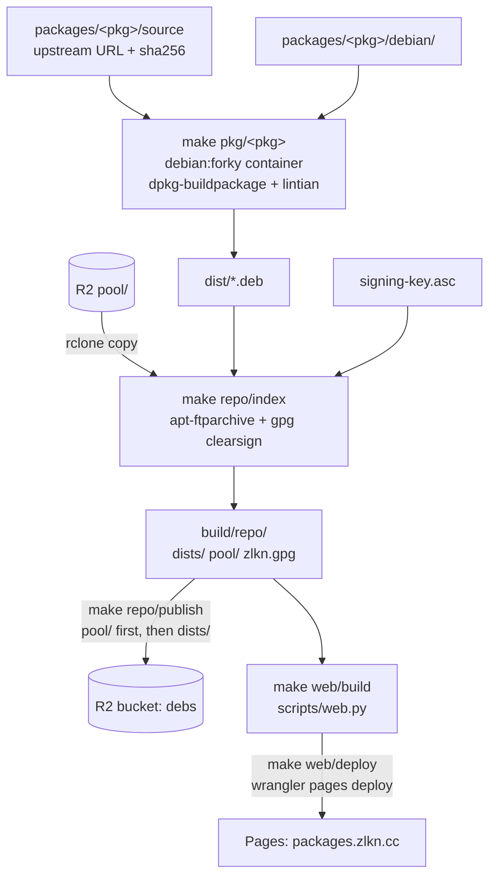

# debs

Personal apt repository for Debian forky with third-party tools that Debian does not ship or ships outdated.

- Repository: <https://apt.zlkn.cc>
- Package list: <https://packages.zlkn.cc>

## Usage

```sh
sudo install -d -m755 /etc/apt/keyrings
sudo curl -fsSL https://apt.zlkn.cc/zlkn.gpg -o /etc/apt/keyrings/zlkn.gpg
printf 'Types: deb\nURIs: https://apt.zlkn.cc\nSuites: forky\nComponents: main\nSigned-By: /etc/apt/keyrings/zlkn.gpg\n' | sudo tee /etc/apt/sources.list.d/zlkn.sources >/dev/null
sudo apt update
sudo apt install lua-language-server
```

## Architecture



`infra/` manages both buckets, both domains and the Pages project with Terraform.

## Build and publish



```sh
make pkg/lua-language-server
make repo/index
make repo/publish
make web/deploy
```

Published files in `pool/` are immutable: `repo/publish` refuses to overwrite a `.deb` with different content, so every rebuild needs a new version.

## Adding a package

1. Create `packages/<pkg>/source` with one line: `<sha256>  <upstream tarball URL>`.
2. Create `packages/<pkg>/debian/` (`changelog`, `control`, `copyright`, `rules`, `source/format`). Use `packages/lua-language-server` as a template.
3. Version packages as `<upstream>-0~zlkn<n>`, so an official Debian package of the same upstream version takes precedence.
4. Run `make pkg/<pkg>` and fix every lintian error and warning, or override it with a reason.

To update a package, change the URL and sha256 in `source` and add a `debian/changelog` entry.

## Setup

Secrets live in `.env`, which `make` loads automatically and git ignores:

| Variable | Used by | Permissions |
|---|---|---|
| `TF_CLOUDFLARE_API_TOKEN` | `tf/*` | Account: Workers R2 Storage Edit, Cloudflare Pages Edit; Zone `zlkn.cc`: Zone Read, DNS Edit |
| `PAGES_CLOUDFLARE_API_TOKEN` | `web/deploy` | Account: Cloudflare Pages Edit |
| `AWS_ACCESS_KEY_ID`, `AWS_SECRET_ACCESS_KEY` | `repo/*` | R2 token: Object Read & Write on bucket `debs` |
| `CLOUDFLARE_ACCOUNT_ID` | `repo/*`, `web/deploy` | |

`make key` creates the ed25519 signing key in the local GnuPG keyring and exports `signing-key.asc` (private, git-ignored) and `zlkn.gpg` (public). The key expires after two years: extend it with `gpg --quick-set-expire`, rerun `make key` and republish.

Requirements: Docker, GNU make, Terraform, wrangler, Python 3, `dpkg-deb`.

## Infrastructure

```sh
make tf/plan
make tf/apply
```

`tf/apply` applies the plan saved by the last `tf/plan`. Terraform state is local for now.
